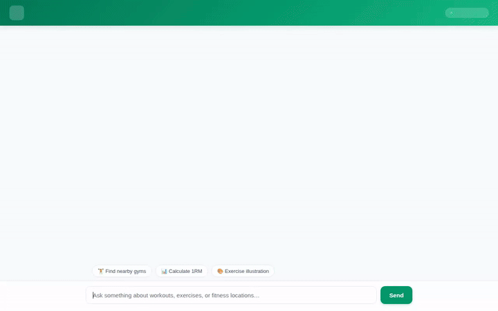

# Fit Coach AI

Fit Coach AI is an autonomous, personalized AI fitness coach assistant built using the Google Agent Development Kit (ADK) and deployed to Agent Engine on Google Cloud Platform. It manages workout logs, calculates training targets, discovers nearby fitness facilities, generates visual workout guides, and remembers user preferences across sessions.



---

## Implemented Capabilities & Tools

Fit Coach AI is backed by Google Cloud services and specialized fitness tools:

### 🧠 Vertex AI Memory Bank
- **Long-Term Memory Persistence**: Automatically logs session events and extracts user fitness goals, personal records, and exercise history across conversations using `VertexAiMemoryBankService`.
- **Memory Retrieval**: Uses `PreloadMemoryTool` and `LoadMemoryTool` to inject relevant memories into conversation context.

### 🏋️ Firestore Exercise Database
- **Exercise Search (`search_exercises`)**: Queries exercises from Google Cloud Firestore by muscle category (e.g., Chest, Legs) or equipment (e.g., Barbell, Dumbbell).
- **Exercise Management (`add_exercise`)**: Adds custom exercise definitions directly to the Firestore collection.

### 📊 Training & Workout Calculations
- **1RM Calculator (`calculate_one_rep_max`)**: Computes estimated one-rep max (1RM) using the Epley formula and outputs training targets at 90%, 80%, and 70% intensity levels.
- **Wger Fitness API (`get_public_exercise_info`)**: Fetches open-source exercise data from the Wger fitness API.

### 📍 Location & Nearby Places
- **Geocoding API (`geocode_address`)**: Converts addresses and city names into geographic latitude and longitude coordinates.
- **Places API New (`search_nearby_places`)**: Finds nearby gyms, fitness centers, and sports complexes within a customizable radius.

### 🎨 Multimodal Media Generation & Storage
- **Vertex AI Image Generation (`generate_exercise_image`)**: Generates high-quality exercise illustrations using `gemini-3.1-flash-lite-image` in the `global` region.
- **Google Omni Video Generation (`generate_exercise_video`)**: Generates short exercise video animations using `gemini-omni-flash-preview` in the `global` region.
- **Google Cloud Storage Integration**: Uploads generated images and videos directly to a public Cloud Storage bucket (`fit-coach-ai-assets-qwiklabs-gcp-03-5d4f25a91be7`) and returns shareable HTTPS links.

### 💻 Code Execution & Rich UI
- **Agent Engine Sandbox (`AgentEngineSandboxCodeExecutor`)**: Executes Python code in a safe sandbox environment for complex calculations.
- **A2UI Rich UI Catalog**: Uses A2UI v0.8 Basic Catalog to render structured cards, lists, and images in the user interface.

---

## Architecture

```
┌─────────────────────────────────────────────────────────────┐
│                   FastAPI Proxy Chat UI                     │
└──────────────────────────────┬──────────────────────────────┘
                               │ A2A Protocol
┌──────────────────────────────▼──────────────────────────────┐
│                Fit Coach AI (ADK Agent)                     │
│               Deployed to Agent Engine                      │
└──────┬──────────────────────┬──────────────────────┬────────┘
       │                      │                      │
┌──────▼───────┐       ┌──────▼───────┐       ┌──────▼───────┐
│ Memory Bank  │       │  Firestore   │       │ Cloud Storage│
│ (Vertex AI)  │       │ (Exercises)  │       │   (Assets)   │
└──────────────┘       └──────────────┘       └──────────────┘
```

---

## Local Development & Setup

### Prerequisites
- Python 3.11+
- `uv` package manager
- Google Cloud SDK (`gcloud`) authenticated with Application Default Credentials (ADC)

### Environment Variables
Set the required environment variables:
```bash
export GOOGLE_MAPS_API_KEY="YOUR_KEY"
export WGER_API_KEY="YOUR_KEY"
```

### Running the Agent Locally
To start the ADK agent server locally:
```bash
uv run python -m google.adk.cli run app
```

### Running the Frontend Locally
To run the FastAPI chat proxy:
```bash
cd frontend
uv run python main.py
```
The server will start on port 8080.
